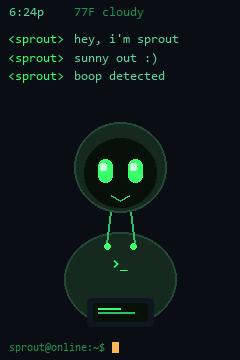
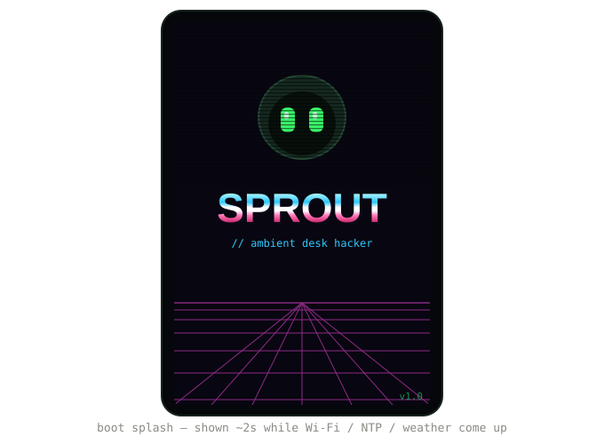
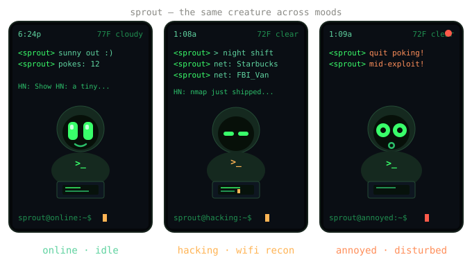
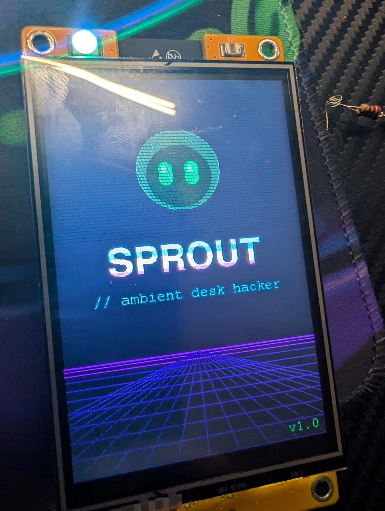
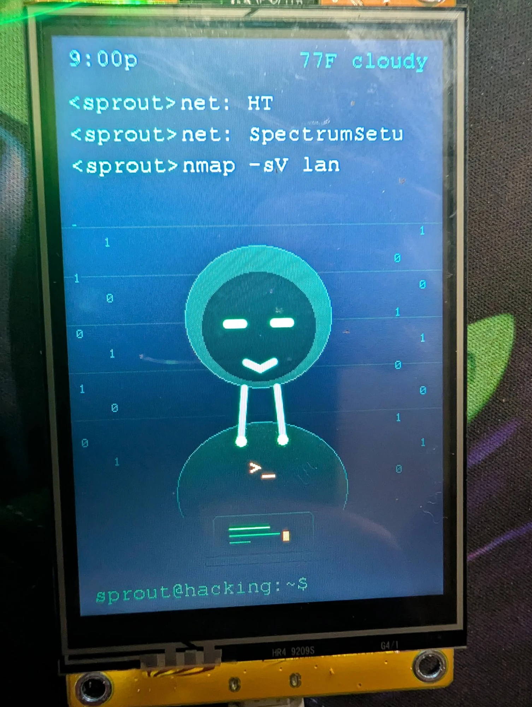

# Sprout

An ambient desk companion for the 3.5" Cheap Yellow Display
(Sunton **ESP32-3248S035R**, ST7796 320×480, resistive XPT2046 touch).

Not a stat-tending Tamagotchi — a little hooded hacker that *lives* on your
desk: breathes, blinks, chats in IRC style, reacts when you touch it, pulls
night shifts, and reacts to real-world data (weather, Hacker News, a host
monitor, Wi-Fi it can see).

<p align="center"></p>





*Mockups — the real panel adds the breathing/blink motion, the scrolling
ticker, and the live clock.*

> 🤖 Built with AI, for fun.

## On real hardware

<p align="center">
  
  
</p>

Boot splash, and hacking mode mid Wi-Fi recon (`net:` SSIDs, `nmap -sV lan`).

## Features

- **Alive on screen** — flicker-free (off-screen sprite) breathing, randomized
  blinking, and mood-driven expressions.
- **IRC-style chat** — a scrolling `<sprout> …` log. Ambient chatter is rare
  (~1 line / 5 min); events (reactions, mode changes, alerts) speak as they
  happen.
- **Touch reactions** — tap him (hit-tested to his body) and he reacts: a happy
  hop + chirp + green LED pop; rapid pokes → startled. The shell prompt tracks
  his state: `sprout@online:~$` / `@happy` / `@annoyed` / `@hacking`.
- **Real day/night** — NTP time (POSIX timezone, DST-aware), shown as a live
  clock. A demo mode runs the day fast for testing.
- **Hacking mode** — left alone during the day he slips into focus: narrowed
  eyes, leaning at the laptop, scrolling code, a pulsing amber `>_`, amber LED,
  and the status in the prompt. **At night he's always hacking** (night owl);
  disturb his session and he gets annoyed (startled, red flash, low buzz).
- **Wi-Fi recon while hacking** — scans for networks and announces any new
  SSID it sees (`net: <ssid>`), one at a time so it narrates rather than floods.
- **Weather** — current temperature + condition (Open-Meteo, no API key) in the
  status bar, with condition-flavoured chatter (he likes storms).
- **Hacker News ticker** — scrolls the front-page headlines across the screen.
- **Host monitor** — TCP-connect check to a host:port; he reacts on state
  change (annoyed + red + buzz when it drops, happy + green on recovery).
- **Sound + light** — buzzer chirps and an RGB LED that echoes his mood
  (green idle, amber hacking, red startled).
- **Remembers you** — boot count and total pokes persist across reboots (NVS);
  he greets with continuity.
- **Boot splash** — a synthwave title card, or your own `/splash.jpg` from SD.

## Configuration

**Full reference: [docs/CONFIG.md](docs/CONFIG.md).** Quick version:

Settings are layered — each source overrides the one before it:

1. **Compiled defaults** — `src/config.h` (gitignored; copy from
   `src/config.example.h`).
2. **SD card** — drop a `/sprout.json` on a FAT32 card (see
   `sprout.example.json`). Read at boot, *before* Wi-Fi, so it can set the
   network itself.
3. **Web URL** — if the config has a `config_url`, that JSON is fetched after
   Wi-Fi connects and merged on top.

Keys (all optional — anything omitted keeps the previous value):
`wifi_ssid`, `wifi_pass`, `tz` (POSIX), `hour24` (bool), `lat`, `lon`,
`demo` (bool), `day_ms`, `hack_after_s`, `hn` (bool), `monitor_host`,
`monitor_port`, `config_url`.

The SD slot is on the board's own VSPI bus (CS 5), separate from the display,
so runtime config never fights the screen for the bus.

### Wi-Fi credentials are never read from the URL config

`wifi_ssid` / `wifi_pass` are honoured **only from local sources** (compiled
config or the SD card) — never from the fetched URL. Two reasons:

- **It would leak your password.** A config served over the network means your
  Wi-Fi password lives on a web server. Even over HTTPS the fetch here skips
  cert verification, so it isn't a safe place to put a secret.
- **It's pointless anyway.** The URL config is fetched *after* the device is
  already online, so credentials in it couldn't do anything this session.

Put Wi-Fi creds in `config.h` or on the SD card; use the URL only to retune
non-secret things (timezone, location, feeds, the monitor target, behaviour).

### Signed remote config (optional)

Set `CONFIG_HMAC_KEY` to require a valid HMAC-SHA256 signature on the fetched
config — the device fetches `<config_url>.sig` and rejects the config unless it
matches. Empty key = unsigned (trusted as-is). Sign the hosted file with:

```bash
openssl dgst -sha256 -hmac "YOUR_SECRET" sprout.json | awk '{print $2}' > sprout.json.sig
```

## Pin map (bare CYD — no radios, nothing contends for the display SPI)

| Function | Pin(s) | Notes |
|---|---|---|
| Display ST7796 (HSPI) | SCLK 14, MOSI 13, MISO 12, CS 15, DC 2, RST −1 | BGR, inversion off |
| Backlight | **27** | active HIGH, PWM = brightness (not 21) |
| Touch XPT2046 | CS 33 (shares display SPI) | single-point resistive; calibrated in firmware |
| Speaker / buzzer | 26 | SPEAK1; chirps on reactions and alerts |
| RGB LED | R **4**, G **17**, B **16** | common-anode (active LOW); G/B are swapped from the usual CYD order on this board |
| SD card (VSPI) | CS 5, SCK 18, MISO 19, MOSI 23 | runtime config + boot image |

There is **no onboard LDR** on this 035 board, so day/night runs off the clock,
not a light sensor. Pin values are from on-hardware measurement.

## Build & flash

```bash
pio run -t upload && pio device monitor
```

Then copy `src/config.example.h` to `src/config.h` and fill in your Wi-Fi,
timezone, and location (or leave `DEMO_DAYNIGHT 1` to try it offline with a
fast simulated day).

## License

MIT — see [LICENSE](LICENSE).
